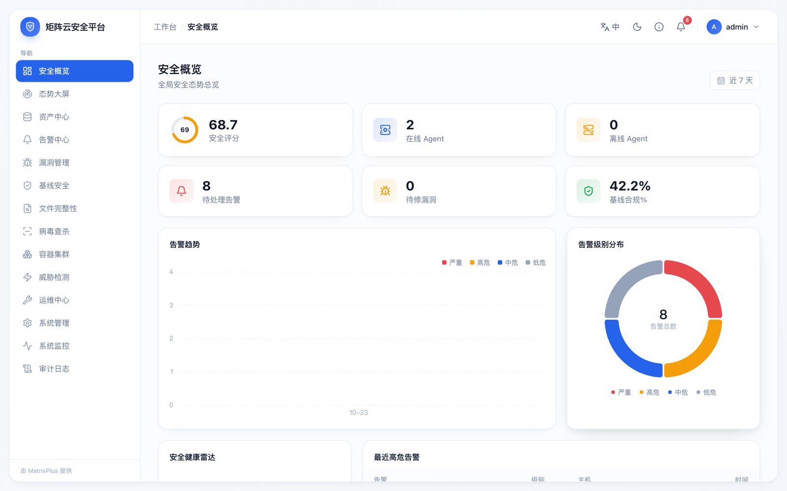
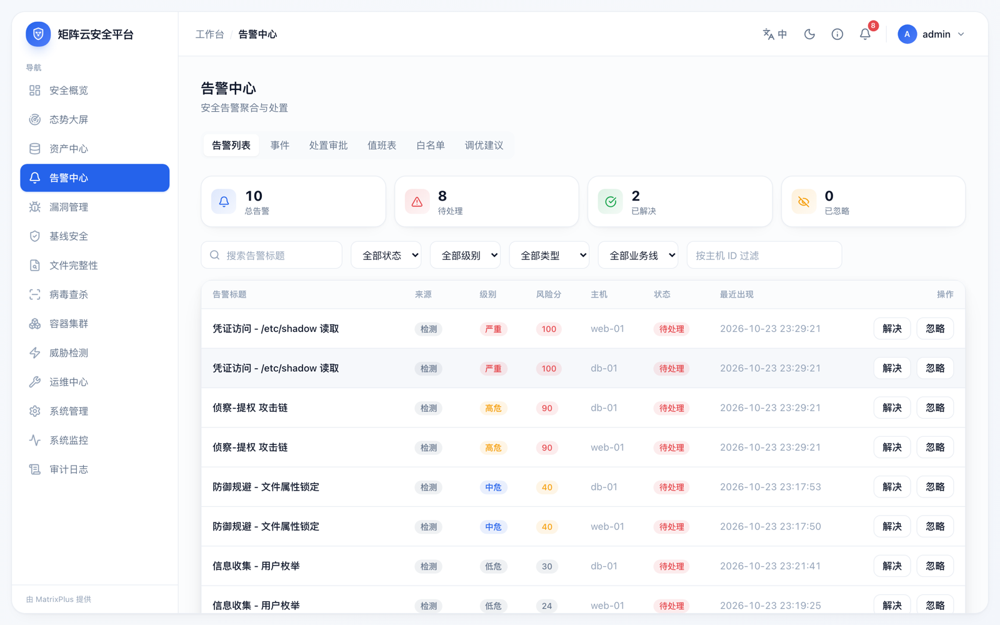
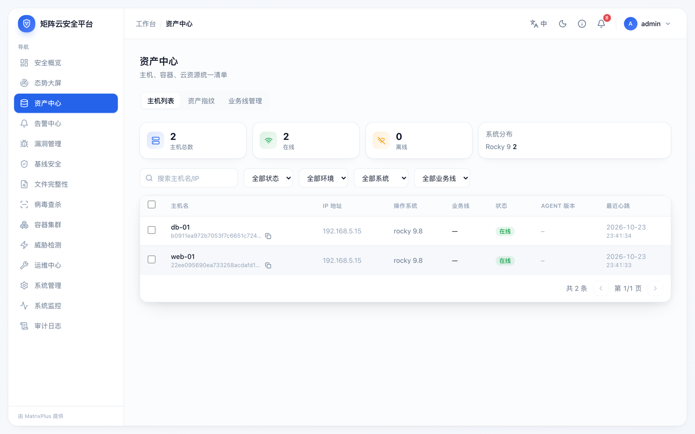
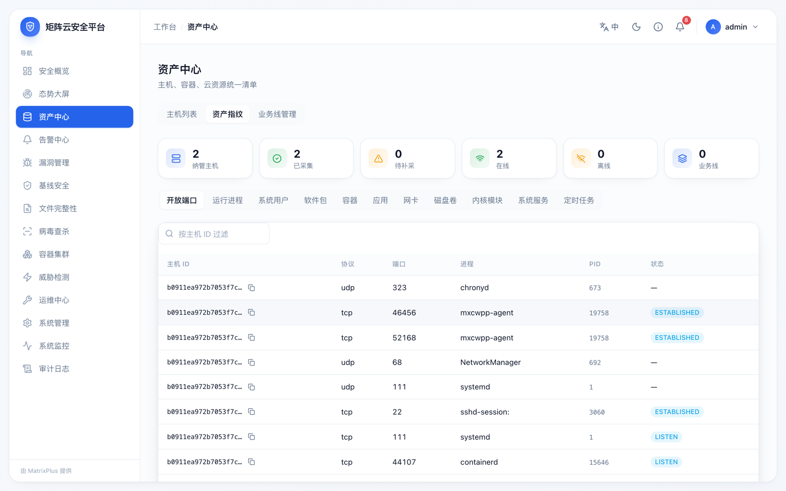
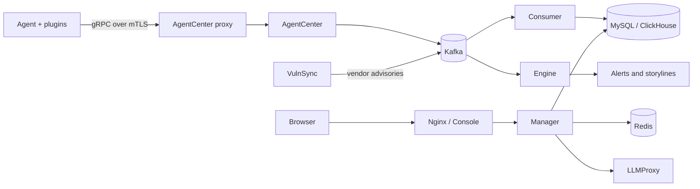
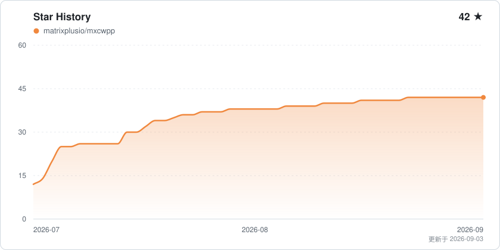

# MxCwpp

**English | [中文](README_ZH.md)**

[](https://github.com/matrixplusio/mxcwpp/actions/workflows/ci.yml)
[](https://github.com/matrixplusio/mxcwpp/releases)
[](https://github.com/matrixplusio/mxcwpp)
[](LICENSE)
[](https://github.com/matrixplusio/mxcwpp/stargazers)
[](https://github.com/matrixplusio/mxcwpp/issues)
[](https://github.com/matrixplusio/mxcwpp/commits/main)
[](https://goreportcard.com/report/github.com/matrixplusio/mxcwpp)

An open-source host and container security platform (CWPP) for Linux and Kubernetes. It covers security baselines, asset inventory, vulnerability management, malware scanning, file integrity monitoring, runtime detection and response, and gives security operations teams a single management console.

The whole platform is in this repository — agent, plugins, backend services and console — free to deploy under AGPL-3.0.

**Status:** production-ready. Versions follow [Semantic Versioning](https://semver.org/); see the [CHANGELOG](CHANGELOG.md) for changes between releases.

## Capabilities

| Area | What it does |
|------|--------------|
| Security baseline | CIS Benchmark, MLPS 2.0 (等保) and middleware checks — 30 policies, 614 rules; single-host and batch auto-remediation |
| Asset inventory | Processes, ports, users, packages, containers and more, with relationship mapping, global fingerprinting and export; Kubernetes cluster assets |
| Vulnerability management | Package PURL collection, OS vendor advisories plus OSV.dev matching, CVSS v3.1 scoring, SBOM and VEX (CycloneDX 1.5 / CSAF 2.0) export |
| Malware scanning | ClamAV and YARA-X engines, scan tasks and file quarantine |
| File integrity monitoring | AIDE-based FIM with policies, events and tasks |
| Runtime detection | eBPF event collection, CEL rule engine with MITRE ATT&CK mapping, behavioral sequence rules, ML anomaly scoring |
| Memory and rootkit detection | memfd_exec, process hollowing, shellcode injection, LSASS dump; DKOM hidden PID / kernel module / port / LD_PRELOAD |
| Kubernetes security | Cluster management, container CIS baseline, audit-log intrusion detection via audit webhook |
| AD / LDAP audit | DCSync, Kerberoasting, brute force, off-hour RDP, privilege assignment and more |
| Alerting and response | Aggregation, whitelists, attack storyline (ATT&CK kill-chain timeline), kill / quarantine / network block |
| Threat intelligence | MISP IOC import with real-time matching in the rule engine |
| Threat hunting | SPL-like query language translated to SQL over the ClickHouse event archive |
| Operations | Audit log, component and plugin distribution, Prometheus monitoring, inspection reports |

**In development, not yet shipped:** honeypot sensors (SSH / HTTP decoys), NPatch eBPF virtual patching (Log4j proof of concept only), Windows support.

## Screenshots

<table>
  <tr>
    <td><br><b>Security overview</b></td>
    <td><br><b>Alerts</b></td>
  </tr>
  <tr>
    <td><br><b>Hosts</b></td>
    <td><br><b>Asset fingerprint</b></td>
  </tr>
</table>

Screenshots are taken from a demo environment with synthetic data.

## Architecture



The backend consists of seven services: Manager, AgentCenter, Consumer, Engine, LLMProxy, VulnSync and Scanner (optional, container image scanning). The control plane is stateless and scales horizontally. Kafka decouples persistence from detection (separate consumer groups with independent offsets), Redis handles service discovery and distributed locks, and ClickHouse stores time-series analytics and the event archive. VulnSync pulls OS vendor advisories and publishes them to Kafka for matching against host software.

See [Architecture](docs/development/architecture.en.md) for details.

## Tech Stack

| Layer | Technology |
|-------|------------|
| Backend | Go 1.26 (Gin / gRPC / GORM / Zap) |
| Frontend | Next.js 15 + React 19 + TypeScript + TailwindCSS + Zustand + TanStack Query |
| Storage | MySQL 8.0+ / Redis 7 / ClickHouse 24 |
| Messaging | Kafka (KRaft mode) |
| Monitoring | Prometheus |
| Communication | gRPC bidirectional streaming + mTLS + Protobuf |
| Deployment | Docker Compose / systemd + Nginx |

## Supported Platforms

**Host OS**: Rocky Linux 9/10, Oracle Linux 7/8/9, CentOS 7/8/9, Debian 10/11/12, Ubuntu 20.04/22.04

**Runtime**: Physical and virtual machines, Docker hosts, Kubernetes nodes and clusters

## Quick Start

### Prerequisites

- Linux or macOS with Docker 24+ and Docker Compose v2
- At least 4 CPU cores, 8 GiB RAM (16 GiB recommended) and 50 GiB disk — the full stack uses about 6 GiB of memory
- Ports 80 / 443 for the console and 6751 for agents. If 80 / 443 are taken, run `cp .env.example .env` in `deploy/` first and change `HTTP_PORT` / `HTTPS_PORT`

### 1. Start the platform

```bash
git clone https://github.com/matrixplusio/mxcwpp.git
cd mxcwpp/deploy
./deploy.sh quickstart
```

`quickstart` generates every password, key and certificate, pulls the images, starts a single-node stack and waits until all services are healthy. It is safe to run again: the existing `.env` and certificates are kept. Set `SERVER_IP=<address>` in front of the command if the detected address is not the one agents will use.

Check that it is up:

```bash
docker compose ps                                   # every service running / healthy
curl -k https://<SERVER_IP>/api/v1/health           # "status":"ok"
```

Open `https://<SERVER_IP>` (the certificate is self-signed) and sign in as `admin / admin123`. You will be asked to change the password.

### 2. Connect the first host

1. In **System → Basic settings**, set the backend URL to `https://<SERVER_IP>`. Agents download plugins and updates from this address.
2. Build the agent and plugin packages and upload them in **Operations → Components** — the agent package goes to the `agent` component, each plugin to the component of the same name:
   ```bash
   make package-agent-all   VERSION=1.0.0 SERVER_HOST=<SERVER_IP>:6751
   make package-plugins-all VERSION=1.0.0
   ```
3. On the host, trust the platform CA (`deploy/certs/ca.crt`), then run the installer with the enroll token (`ENROLL_TOKEN` in `deploy/.env`):
   ```bash
   sudo cp ca.crt /etc/pki/ca-trust/source/anchors/mxcwpp-ca.crt && sudo update-ca-trust
   # Debian / Ubuntu: copy to /usr/local/share/ca-certificates/mxcwpp-ca.crt and run update-ca-certificates

   read -rs MXCWPP_ENROLL_TOKEN && export MXCWPP_ENROLL_TOKEN
   export MXCWPP_HTTP_SERVER=https://<SERVER_IP> MXCWPP_AGENT_SERVER=<SERVER_IP>:6751
   sudo -E bash -c "$(curl -fsSL https://<SERVER_IP>/agent/install.sh)"
   ```

The host appears under **Assets → Hosts** within a minute. Agents run on hosts managed by systemd; plugins are not deployed to container hosts.

### 3. Stop and clean up

```bash
./deploy.sh stop                       # stop, keep data
docker compose down                    # remove containers; data stays in deploy/data
```

To start over, also delete `deploy/data`, `deploy/certs/*.crt`, `deploy/certs/*.key` and `deploy/.env`.

See [Deployment](docs/operations/deployment.en.md) for cluster deployment, HA, upgrades and backups.

### Known limitations

- With a non-default `HTTPS_PORT`, the HTTP-to-HTTPS redirect drops the port — open the HTTPS port directly.
- Vulnerability matching for Rocky Linux only covers advisories published after the first start.

## Build

```bash
make build-server                                        # Build server
make build-consumer                                      # Build consumer
make package-agent-all VERSION=1.0.0 SERVER_HOST=IP:6751 # Package agent (RPM/DEB)
make package-plugins-all VERSION=1.0.0                   # Package plugins
make proto                                               # Generate Protobuf code
make test                                                # Run tests
make lint                                                # Lint
```

## Project Structure

```
mxcwpp/
├── cmd/
│   ├── agent/              # Agent entry point
│   ├── server/             # agentcenter / consumer / engine / llmproxy / manager / scanner / vulnsync
│   └── tools/              # mxctl (cluster deployment), replay, ETL, migration and load-test tools
├── internal/
│   ├── agent/              # Agent (connection, transport, plugin management, EDR modules)
│   ├── server/             # Backend services and shared server packages
│   ├── common/             # Packages shared by agent and server
│   └── deploy/             # Deployment rendering and repository checks
├── plugins/                # avscanner / baseline / collector / fim / logcollector / remediation / scanner
│                           # rasp-go / rasp-java / rasp-node / rasp-php / rasp-python; lib/ is the shared plugin SDK
├── api/proto/              # Protobuf definitions
├── web/                    # Console (Next.js 15 + React 19 + TypeScript)
├── configs/                # Configuration samples and detection rules
├── deploy/                 # Docker Compose, Nginx, systemd and cluster deployment
├── sdk/                    # Client SDKs (Go / Java / Python)
├── scripts/                # Build and deployment scripts
├── tests/                  # API, end-to-end, performance and rule tests
└── docs/                   # Documentation
```

## Documentation

- [Architecture](docs/development/architecture.en.md) - System topology, component responsibilities, data pipeline, HA design
- [Deployment](docs/operations/deployment.en.md) - Prerequisites, single-node and cluster deployment, agent installation, upgrades and backups
- [Configuration](docs/operations/configuration.md) - Server and agent configuration, environment variables
- [API Reference](docs/reference/api-reference.md) - REST endpoints, request/response formats, authentication
- [FAQ](docs/operations/faq.md) - Common issues and troubleshooting
- [Development](docs/development/development.md) - Local setup, database migrations, plugin development
- [Contributing](CONTRIBUTING.md) - How to report bugs and request features
- [Governance](docs/governance.md) - Project roles, decision process, security policy

The Deployment and Architecture guides are available in English; the other documents under `docs/` are currently in Chinese. See the [documentation index](docs/README.md).

## Star History

[](https://github.com/matrixplusio/mxcwpp/stargazers)

## Contributors

See [CONTRIBUTORS.md](CONTRIBUTORS.md).

## License

[GNU Affero General Public License v3.0](LICENSE)

AGPL-3.0 requires that modifications remain available under the same licence, including when the software is offered as a network service.
